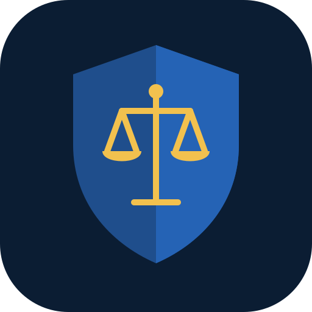
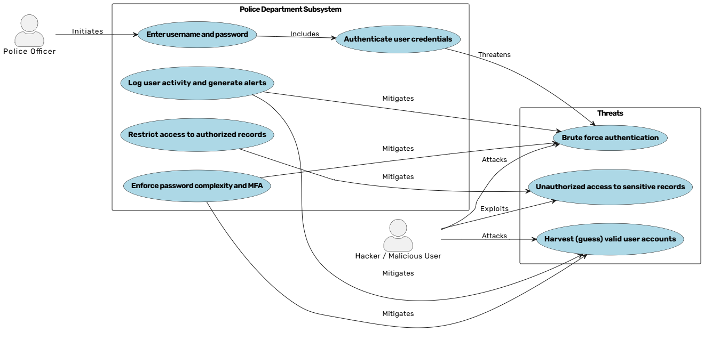
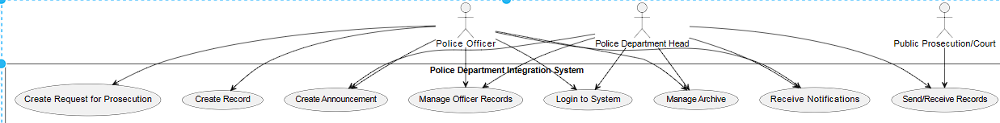
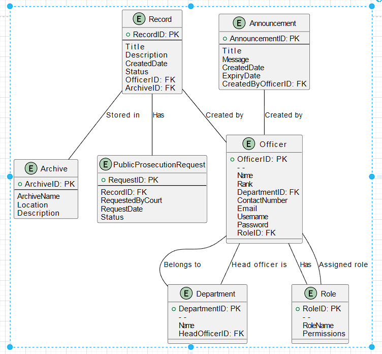
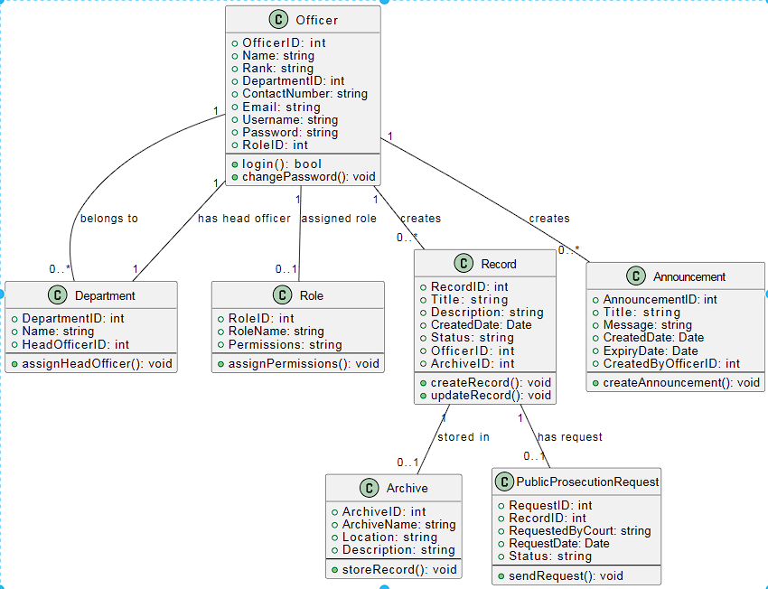
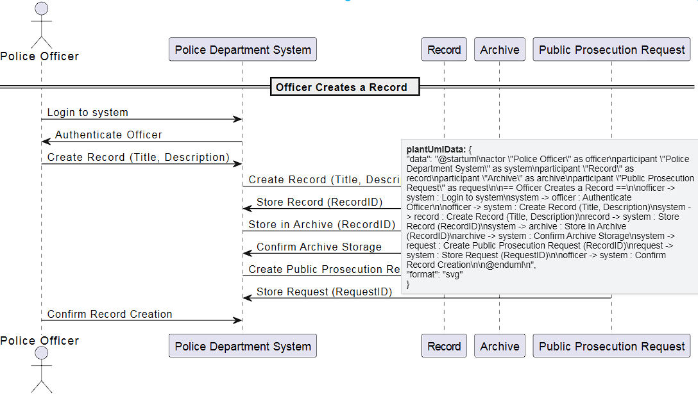

<div align="center">



# Police Department Integration Subsystem

**A secure-by-design system that connects police departments with prosecutors and courts, with security built into the requirements and threat model from the start.**


</div>

---

## Overview

This is my **Secure Software Engineering** project (3rd year, Cyber Security, Ar-Rasheed University). The goal: design a subsystem of a national **Judicial Management System** that lets police departments create, archive and exchange records with the **Public Prosecution and Courts**, where security comes first, not last.

The project follows a **secure SDLC**: security requirements → threat modeling → risk ranking → mitigations → design. The full 50-page report is in [`docs/police-integration-system.pdf`](docs/police-integration-system.pdf).

## Subsystems

| Subsystem | Responsibility |
|---|---|
| **Officers' Management** | Officer accounts created by the department head only, MFA on password reset, role-based record access, auto-logout on inactivity |
| **Announcement Management** | Create records with a unique ID and timestamp, multimedia evidence upload, archiving in under 20 s, sync to the JMS every 3 days |
| **PDLAI** (Police Department ↔ Legislative Authorities Integration) | Exchange records with prosecutors and courts, notifications, and alerts for requests left unchecked for more than 3 days |

## Security requirements

Functional requirements are written in **EARS** syntax (`WHEN … the system shall …`, `IF … THEN …`). On top of them, every security property gets its own requirement set:

`Confidentiality` · `Integrity` · `Availability` · `Authentication` · `Authorization` · `Non-repudiation` · `Accountability`

## Threat model (STRIDE)



The misuse-case diagram puts the attacker next to the legitimate officer. It shows each threat (brute force, account harvesting, unauthorized record access) and the control that mitigates it (MFA, password complexity, logging and alerting, record-level access control).

| STRIDE | Example threat | Control |
|---|---|---|
| **S**poofing | Impersonating an officer with stolen credentials or a hijacked session | Authentication, MFA, secure sessions |
| **T**ampering | Altering case records in transit or in the archive | Integrity: end-to-end encryption, hashing |
| **R**epudiation | Denying that a record was submitted or modified | Non-repudiation: signed audit logs |
| **I**nformation disclosure | Exposure of officer or case data | Confidentiality, least privilege |
| **D**enial of service | Overloading report generation or inter-system links | Availability: rate limiting, redundancy |
| **E**levation of privilege | Abusing misconfigured RBAC to reach admin functions | Authorization, RBAC reviews |

The model also catalogues **entry points** and **assets** with trust levels, such as officer login (low trust), department-head login (high trust) and the officer accounts DB (high trust).

## Risk ranking

Threats were ranked three ways and compared:

| Threat | Delphi (consensus) | Average rating | P × I |
|---|:---:|:---:|:---:|
| Spoofing: user impersonation | 1 | 4.75 · Critical | **25** |
| Spoofing: credential tampering | 2 | 4.50 · Critical | 20 |
| Information disclosure | 2 | 4.50 · Critical | **25** |
| Tampering: data modification | 3 | 3.25 · High | 16 |
| Denial of service | 5 | 2.50 · High | 12 |
| Tampering: report alteration | 4 | 2.25 · Medium | 12 |

Each top threat then gets a mitigation card (`T#001`, `T#002`, …) listing its targets, attack techniques, impact and safeguards.

## Design

| Use cases | ER diagram |
|---|---|
|  |  |

| Class diagram | Sequence diagram |
|---|---|
|  |  |

## Process: Agile / Scrum

The plan uses **8 sprints** over about 12 weeks, from November 2024 to February 2025. Development starts with the security-critical features (account creation and login), followed by announcements and archiving, then PDLAI notifications, and ends with testing and UAT.

## Repository contents

```text
police-integration-system/
├── docs/
│   ├── police-integration-system.pdf   # full report (50 pages)
│   ├── police-integration-system.docx
│   └── project-brief.pdf               # course requirements
└── diagrams/                           # misuse case, use case, ER, class, sequence
```

## What I learned

- Writing **testable security requirements**, not "the system should be secure".
- Thinking like an attacker with **misuse cases** and **STRIDE**.
- Prioritizing threats with **Delphi**, average-rating and **P × I** methods, and seeing where they disagree.
- Fitting security work into **Agile sprints** instead of leaving it to the end.

## Author

**Humam Al-Dhubhani**, Cyber Security, Ar-Rasheed University · [GitHub](https://github.com/humamaldhubhani)

<sub>Released under the [MIT License](LICENSE).</sub>
